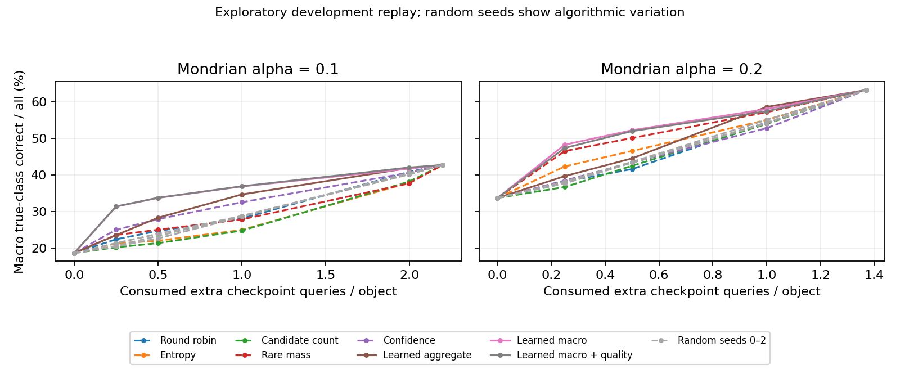

# Exploratory trajectory and continuation results

The contribution is a functioning opt-in framework for class-sensitive trajectory
sets, causal archive-query allocation and learned continuation, with complete
reproduction from the public BTS benchmark. The completed study evaluates **480
fixed-deadline cells and 1,320 allocation cells** across 8,922 development objects,
five object folds and four horizons (5/10/20/100 days). See the
[reproduction workflow and API](../trajectory_benchmark.md).

All results reuse repeatedly inspected development objects. The illustrative
Mondrian alpha .10/budget 1 comparison below was chosen for presentation **after
observing the full grid**. Folds share training/calibration objects; no fresh
confirmatory validation, confidence interval, deployment policy selection or
prospective guarantee is claimed. The framework and measured setting-specific
improvements are useful alongside their limitations.

## Finite resolution and rare emitted labels

TDE calibration counts are 13, 14, 11, 9 and 11. At alpha .05, all Mondrian TDE
thresholds are infinite: TDE remains a candidate for every object, so every
singleton must be TDE. The envelope emits **67 TDE labels: 5 correct and 62 wrong**,
for 7.46% emitted-label precision. At alpha .01 multiple classes cannot be excluded,
so no singleton is possible. Bonferroni-Mondrian at lifetime alpha .20 spends .05
per look and emits 411 TDE labels, only 27 correct.

This is compatible with true-class inclusion. Wrong singletons imply true-class
exclusion, but protecting true TDE objects does not control the fraction of emitted
TDE labels that are wrong. The method exposes this limitation rather than solving
reliable automatic rare-transient publication.

At alpha .10 and a day-100 deadline:

| Set policy | Correct | Wrong | Mean day consumed |
|---|---:|---:|---:|
| Pooled envelope | 7,548 | 820 | 25.68 |
| Mondrian envelope | 4,721 | 382 | 63.56 |
| Mondrian fixed day 100 | 7,120 | 542 | 100.00 |

| True class | Objects | Pooled correct / wrong | Envelope Mondrian | Fixed day-100 Mondrian |
|---|---:|---:|---:|---:|
| SLSN | 132 | 23 / 96 | 13 / 7 | 23 / 13 |
| TDE | 58 | 30 / 22 | 15 / 1 | 33 / 3 |

Envelope Mondrian retains the true class while leaving 112 true SLSN and 39 true TDE
unresolved. Its emitted SLSN precision is 13/90 (14.44%); emitted TDE precision is
15/82 (18.29%). Fixed-deadline and lifetime rules have different timing/protection
properties, so the table establishes no dominance.

## Budgeted continuation

A token reveals one next archived checkpoint; it is not one telescope observation.
Every object initially exposes day 5. Each fold allocates `floor(b*N_fold)` extra
tokens at `b = 0, .25, .5, 1, 2, 3`. Rankers use proper-training early-stop objects,
whose predictions influenced classifier stopping, and training closure targets
based on separately calibrated thresholds. The continuation scores are rankings.

At Mondrian alpha .10 and allocated budget 1 (8,922 extra tokens):

| Policy | Correct | Wrong | Six-class macro correct | Mean nobs consumed | Mean day consumed |
|---|---:|---:|---:|---:|---:|
| Round robin | 2,256 | 135 | 28.12% | 7.48 | 10.68 |
| Entropy | 1,841 | 189 | 24.99% | 10.68 | 24.02 |
| Rare mass | 1,927 | 182 | 27.85% | 12.24 | 27.63 |
| Confidence | 3,377 | 162 | 32.56% | 11.09 | 25.01 |
| Learned aggregate, outputs | 3,821 | 155 | 34.69% | 10.38 | 24.14 |
| Learned macro, outputs | 3,424 | 170 | 36.88% | 10.01 | 21.21 |
| Learned macro, quality | 3,385 | 179 | 36.94% | 9.84 | 21.05 |

The aggregate output learner adds 444 correct decisions relative to confidence,
with seven fewer wrong decisions and lower realized mean nobs/days in this cell.
Correct counts improve in all five folds; errors do not improve in every fold.
Macro reward redistributes useful decisions across classes. All six classes are
represented in the empirical macro means; this is not a rare-only objective.

The improvements are setting dependent. Under pooled alpha .10/budget 1, rare-mass
priority achieves 64.87% macro correct versus 63.73% for both macro learners.
Pooled alpha .10/budget .5 with entropy and pooled alpha .20/budget .25 with rare
mass are further counterexamples. Both macro learners exceed the per-cell best
heuristic/random macro control in the seven nonsaturated Mondrian cells, but this
is a descriptive comparison envelope, not seven independent trials or a deployable
control selected on untouched data.

Quality features show no consistent gain. In the displayed cell they add only
0.061 percentage points of macro correct relative to macro outputs, with 39 fewer
total correct decisions and nine more wrong decisions. They often lose macro
utility at alpha .20. Rare-mass priority correctly recovers 11 SLSN and 15 TDE
(26 combined), versus 10 and 12 (22 combined) for macro quality.

At zero budget all policies agree; at sufficiently large budgets they reach the
same first-closure outcomes. Equal allocated budgets can consume different actual
queries when queues exhaust. Random seeds illustrate algorithmic variation.

## Complete numerical record and checks

- [All rare-set cells](rare_grid.csv): 480 fold cells plus 96 pooled cells.
- [All allocation cells](budget_grid.csv): 1,320 fold cells plus 264 pooled cells.
- [Role/class counts](class_counts.csv).
- [Complete compressed results](results.json.gz): all metrics, confusion matrices,
  class-specific resources, calibration settings and source hashes; decompress and
  compare the SHA-256 with [COMPLETE](COMPLETE).
- [Numerical verification and scientific provenance](verification.json).

Counts are pooled before rates. CSVs retain counts sufficient to reconstruct
true-class error and emitted precision; JSON also retains every descriptive metric.
Raw models, per-object arrays and action ledgers are generated by the runner and
remain outside Git.

The portable implementation exactly reproduces all 480/1,320 archived cell
metrics, candidate/decision arrays and action ledgers. Independent parameter checks
also reproduce all sixty continuation reward/cost pairs exactly. Public-benchmark
feature preparation was rerun for all 8,922 objects and all 190 ordered features at
four horizons, reproducing every value. All twenty classifiers were then refitted
with the original recipe. Every early-stop/calibration/evaluation probability,
truth label, observation count and membership matches the original fold archives
exactly; the final benchmark replay uses these refitted archives.
